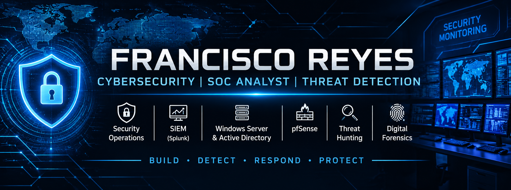

# Francisco Reyes
### Cybersecurity Graduate Student | Aspiring SOC Analyst

Welcome to my GitHub profile!

I am a cybersecurity graduate with a Bachelor of Science in Cybersecurity and currently pursuing a Master of Science in Cybersecurity at Thomas Edison State University.

My goal is to build a career in Security Operations (SOC), focusing on security monitoring, threat detection, incident investigation, and defensive security.

## 🎯 Career Interests
- Security Operations Center (SOC)
- Security Monitoring and Threat Detection
- Incident Response
- Digital Forensics
- Network Security
- Security Information and Event Management (SIEM)

## 🛠️ Technical Skills & Tools

- **SIEM:** Splunk Enterprise
- **Endpoint Monitoring:** Microsoft Sysmon
- **Operating Systems:** Windows Server, Windows, Linux
- **Networking:** TCP/IP, pfSense, network segmentation
- **Identity & Access Management:** Active Directory, DNS
- **Scripting:** Python
- **Log Analysis:** Windows Security Events, Sysmon telemetry
- **Virtualization:** Oracle VirtualBox

## 🔬 Featured Project

### Cybersecurity SOC Home Lab

A hands-on security monitoring environment built with VirtualBox.

**Technologies:** pfSense, Windows Server 2022, Active Directory, Ubuntu Server, Splunk Enterprise, Sysmon.

**Project highlights:**
- Built a segmented virtual network.
- Configured pfSense firewall routing.
- Deployed an Active Directory domain (`corp.local`).
- Connected Windows endpoints to centralized Splunk monitoring.
- Configured Sysmon for endpoint telemetry.
- Created Splunk queries to investigate failed logins and process creation.
- Documented security detection opportunities using MITRE ATT&CK.

**Project repository:** [Cybersecurity SOC Home Lab](https://github.com/francisr94/Cybersecurity-SOC-HomeLab)

## 🎓 Education

**Master of Science in Cybersecurity**  
Thomas Edison State University  
Expected March 2027

**Bachelor of Science in Cybersecurity**  
Thomas Edison State University  
June 2026

## 📚 Currently Learning

- SOC operations and alert triage
- Threat hunting
- Incident response
- Security detection engineering
- CompTIA Security+ preparation

## 🤝 Connect With Me

- LinkedIn: [Francisco Reyes](https://www.linkedin.com/in/francisco-reyes-cyber)
- GitHub: [@francisr94](https://github.com/francisr94)
  
---

*Building practical cybersecurity skills through continuous learning, hands-on labs, and security projects.*
